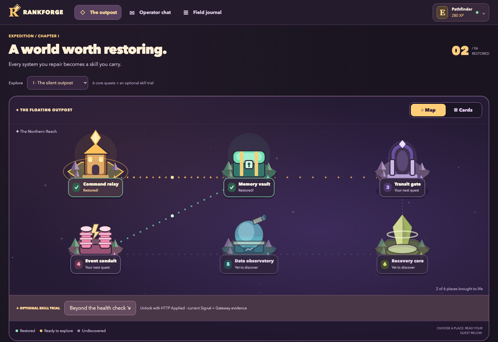

# Rankforge

A personal, local-first engineering learning RPG. Build a living outpost by solving real backend, operations and data problems. Practice English through meaningful conversations, with difficulty adapted to evidence of learning.

[Инструкция на русском: установка, первое задание и работа с чатом](docs/START_RU.md)

[Обзор экранов со скриншотами и пояснениями](docs/TOUR_RU.md)



The preview uses synthetic documentation data, not a personal account or real conversation. Switch between map and quest cards inside the full-width overview; the mission sits directly below it. Navigation and the compact player profile stay at the top. See the [illustrated tour](docs/TOUR_RU.md) for the workspace, chat, skills/rewards, journal and account connection.

The browser is the game, VS Code is the workshop, and the terminal is a real tool. Subscription access uses a direct ChatGPT OAuth adapter; no Codex CLI or paid API fallback is required.

## Development status

Thirty-one labs are executable: six outpost quests, three guild quests (requirements, capacity, consumer contracts), the first twenty-one AI engineering quests of chapter IX (calling and metering a model, measuring it with evaluation sets, judges and release gates, and building the archive from embeddings to cited answers; every quest runs against any OpenAI-compatible endpoint, a local model by default) and one optional HTTP transfer trial. Every quest is open from the start; prerequisites are a recommended order. Four skill paths connect verified outcomes to one-time charge chips, profile frames and the bonus quest. Charge is banked for a future tutor harness; it is not spent or converted into tokens/questions here. The [86-mission course roadmap](docs/COURSE-ROADMAP.md) describes the wider proposed course, not 86 shipped labs. [Acceptance](docs/ACCEPTANCE.md) records real checks and their limits.

An interactive [reward/progression design infographic](public/progression.html) explores 30 ideas in Russian for the owner. Open `/progression.html` on the running local service, or open the standalone file. The actual game remains in English.

## Install and run

Install these prerequisites on macOS or a desktop Linux system:

- [Git](https://git-scm.com/downloads). The source repository is public; cloning does not require the author's account.
- [Node.js](https://nodejs.org/en/download) 24 or newer, including npm. Node24 and25 have been exercised.
- [Python](https://www.python.org/downloads/) 3.10 or newer, available as `python3`.
- [Visual Studio Code](https://code.visualstudio.com/download) 1.110 or newer, with `code` on PATH.
- A desktop Chromium-based browser. [Docker Desktop/Engine with Compose](https://docs.docker.com/get-started/get-docker/) is needed for the nginx gateway lab, not for starting the game or the Python/SQLite labs.

On macOS, add the editor command through the VS Code Command Palette: **Shell Command: Install 'code' command in PATH**, then open a new terminal. See the [official setup instructions](https://code.visualstudio.com/docs/setup/mac#_launching-from-the-command-line).

For ChatGPT login, macOS uses Keychain. Desktop Linux needs `secret-tool` and an unlocked Secret Service keyring in the desktop session; the container QA image does not provide this login environment.

Clone the project and install its build/runtime tools:

```sh
git clone https://github.com/KMNervanin/rankforge.git
cd rankforge
npm ci --include=dev
npm run build
npm start
```

If you already have the checkout, start with `npm ci --include=dev` inside its folder. Development dependencies are included because the source build and local TypeScript launcher use them.

Open `http://127.0.0.1:4173` yourself. The service does not open browser windows or start a login flow automatically. User state lives in `~/.local/share/rankforge`, outside the checkout. Set `RANKFORGE_HOME` to use a different location and `RANKFORGE_PORT` to change the port.

For development, run `npm run dev` and `npm run web:dev` in separate terminals.

Selecting a mission previews its briefing without starting an editor. **Accept mission & open VS Code** or **Open workshop** opens a dedicated extension-development window, so global extension installation is not required. VS Code may ask you to trust the generated workspace on first use. Keep that workshop window open; later workshop actions replace its workspace after the editor's normal unsaved-file handling. A cancelled transition can be retried with **Open workshop**.

In workshop workspaces, the bridge disables generative inline completions and Copilot next-edit suggestions while retaining ordinary IntelliSense for names, methods and parameters. These are workspace settings; your unrelated work projects keep their own editor settings.

Connect your own eligible ChatGPT subscription from the game's **Connection** page. Credentials are stored in macOS Keychain; Linux requires a working Secret Service and `secret-tool`. No existing OpenCode or Codex credential is imported automatically. No API key is accepted. This is subscription usage with its normal limits, not a general-purpose OpenAI API account. The technical labs can be explored without connecting a tutor; sending a tutor message requires the account. If an unauthenticated message is already pending, connect and use **Resume saved answer**.

## Work through a quest

1. Select a sector or use **View quest** in Cards view. Read the current briefing below the overview, then explicitly open VS Code or prepare only the workspace. New workspaces include `MISSION.md` and `LEARN.md`; existing code and annotated documents remain untouched when contracts are clarified.
2. Edit the exercise files, save with Cmd+S/Ctrl+S, and run the lesson commands in the integrated terminal. The game server (`npm start`) and a lesson server (`python3 service.py`) are different processes.
3. Use **Verify lab** to check the saved code. The initial fixtures are deliberately broken. In the HTTP lesson, verification runs its own temporary server rather than observing the terminal process you started.
4. Open **Operator chat** from the navigation or **Open conversation** from the quest. Choose guidance or a debrief. History has its own scroll area; the composer remains visible. Markdown, lists, tables and code fences render directly, and code blocks have a copy button. Enter adds a newline; Ctrl/Cmd+Enter sends.
5. Use **Oldest**, **Latest**, or the new-activity button to navigate a long conversation. Reading older messages does not force you to the bottom when a reply arrives. Drafts, chat mode and the selected conversation survive a page refresh.

The tutor receives bounded snapshots of saved text files inside the quest workspace, including added helper modules, with filenames and saved timestamps. Hidden files, common credential filenames, dependency trees and symlinks are excluded. Unsaved editor buffers and live terminal output are not visible to the tutor. Save changes before asking about code; paste the relevant output when discussing a running process. File snapshots and pasted snippets may represent different versions.

## Update an existing installation

Stop the running game service with Ctrl+C in its terminal, then run these commands from the checkout:

```sh
git pull --ff-only
npm ci --include=dev
npm run build
npm start
```

Refresh the browser tab. Your saves and learner workspaces are outside the checkout and are preserved. If you modified the game's source itself, save those changes before pulling. A second service cannot take over the same save directory; reuse the running instance or stop it before restarting.

For the first mission and remaining personal checks, follow [the handoff](docs/HANDOFF.md). For the implemented and planned learning content, see [the curriculum](docs/CURRICULUM.md).

## Verify

```sh
npm test
npm run build
npx playwright install chromium --only-shell
npm run test:e2e
npm run test:gateway
```

`test:gateway` needs a running Docker engine. It starts a uniquely named temporary Compose project, demonstrates a failing and repaired route, then removes only that project's containers/network/volumes. Existing Docker context and other projects are left alone. Python checks execute trusted learner code locally with a restricted environment and a timeout; they are not a security sandbox for arbitrary uploaded code.

The gateway exercise uses `GATEWAY_PORT=45113 docker compose up -d` if its default port45103 is occupied. The verifier discovers the actual published port. The service uses port4173 by default; one process owns each save directory, so starting a second instance does not rotate its editor credentials or interrupt pending evaluations.

`npm run extension:package` creates an optional VSIX. Do not install it into all workspaces by default; the game-scoped development window is sufficient.

The core runtime also has a reproducible Linux check:

```sh
docker build -f tests/linux.Dockerfile -t rankforge-linux-check .
docker run --rm --cpus=2 --memory=2g rankforge-linux-check
docker image rm rankforge-linux-check
```

Both arm64 and amd64 builds/tests were exercised. This container check does not launch a browser or desktop editor and does not provide a Secret Service login session.

## Principles

- Technical outcomes come from actual lab checks, not a model's praise.
- English feedback accepts free phrasing and preserves quoted evidence.
- Practice completion and independent mastery are separate.
- Quota exhaustion saves the submitted answer and pauses tutoring; local labs and static hints remain available. Resume never duplicates rewards.
- Each mission has its own workspace. Switching never overwrites previous work.
- The local service manages only Rankforge workspaces; existing projects and Docker contexts are preserved.
- Reading/writing evidence does not claim speaking or listening proficiency.

## Project notes

- [Implementation plan](docs/PLAN.md)
- [First-run handoff](docs/HANDOFF.md)
- [Decision log](docs/decisions-2026-10-03.md)
- [Curriculum](docs/CURRICULUM.md)
- [Complete course catalog](docs/COURSE-ROADMAP.md)
- [Skills and reward design](docs/PROGRESSION-DESIGN.md)
- [Current session handoff](docs/SESSION-2026-10-06.md)
- [Third-party notices](THIRD_PARTY_NOTICES.md)

Public source, local execution. Each person uses their own account and saves; this repository does not expose a hosted tutor or a shared subscription gateway. Desktop macOS is the first personally exercised target; Linux core-runtime checks are described above. Native Windows desktop integration has not been validated.
