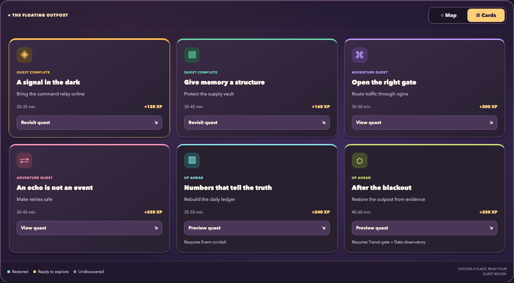
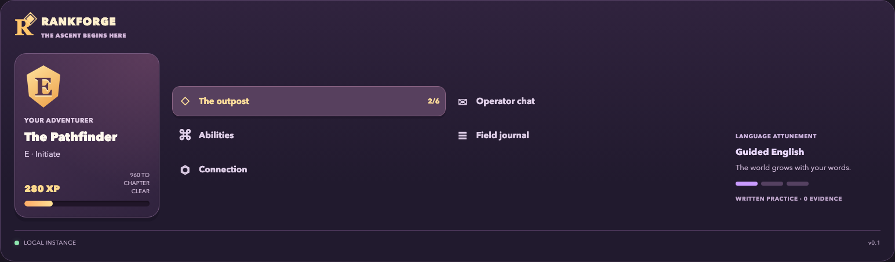
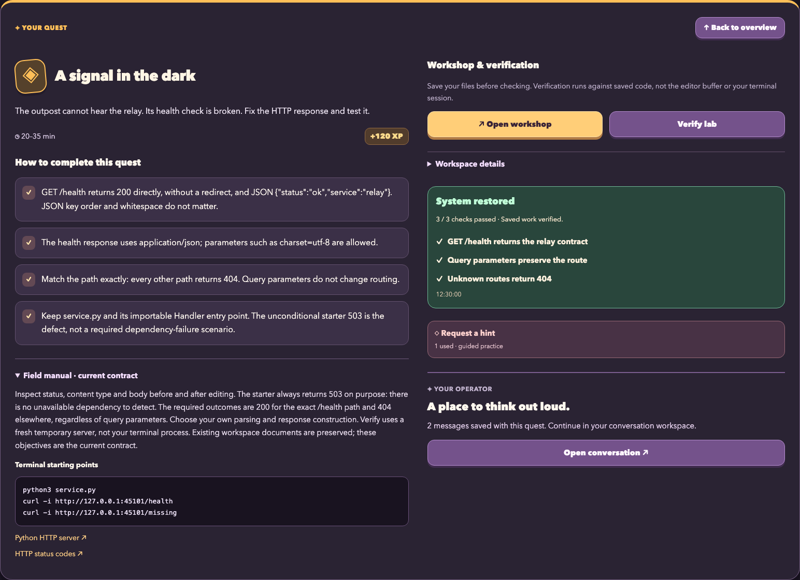
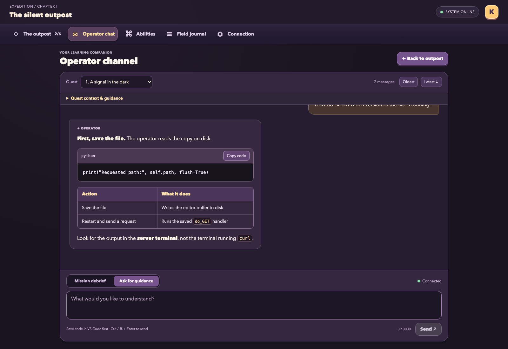
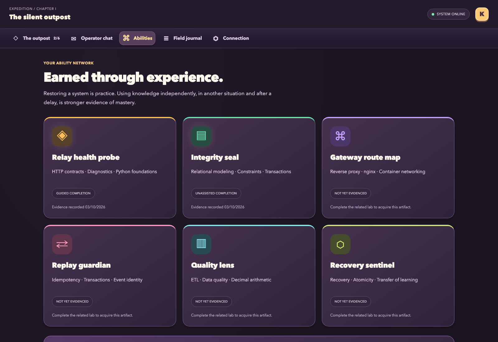
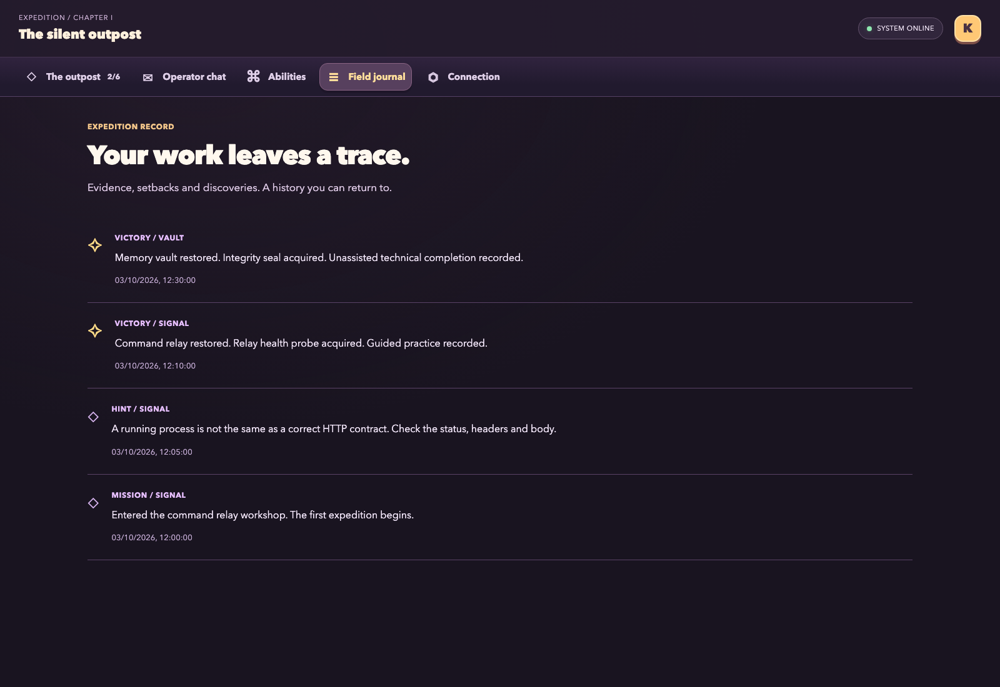
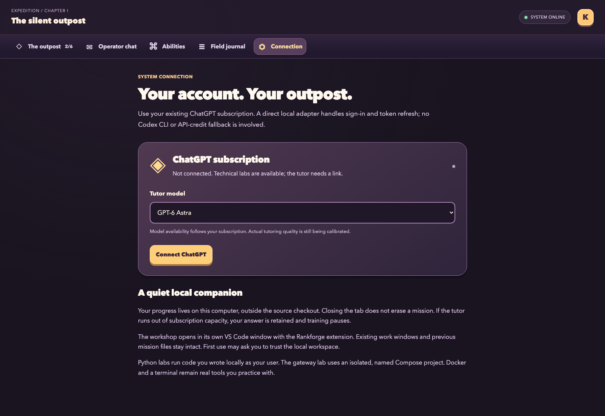

# Как устроен Rankforge

Это обзор основных экранов. Для установки начни с [пошаговой инструкции](START_RU.md).

Все изображения ниже сняты в отдельном headless-браузере на специально подготовленных демонстрационных данных. Личная переписка, аккаунты и сохранения автора не используются. Ответ в примере чата написан для иллюстрации интерфейса, а не получен от живой модели. В новой установке ты начинаешь с собственной пустой истории.

## 1. База — твоя карта обучения


- **Карта во всю ширину:** здания соответствуют заданиям. Связи показывают последовательность и зависимости. После успешной проверки сектор меняется визуально.
- **Map / Cards на самой карте:** два представления одних заданий. Они заменяют друг друга; выбранный вид сохраняется после перезагрузки.
- **Карточка персонажа и меню ниже карты:** ранг и опыт за выполненные задания. Это игровые показатели, а не профессиональный грейд.
- **The outpost:** возвращает на карту.
- **Рабочее пространство ниже меню:** нажатие на сектор или **View quest** переводит к условиям выбранного задания. Даже закрытую миссию можно предварительно прочитать; VS Code открывается отдельной кнопкой.





В демонстрационном сохранении выполнены две миссии. В твоей первой сессии база ещё будет ждать восстановления.

## 2. Панель задания — что сделать и как проверить



- **Описание:** объясняет ситуацию простым английским.
- **Open workshop:** открывает или возвращает учебное окно VS Code. Папка предыдущей миссии сохраняется.
- **Verify lab:** запускает техническую проверку сохранённых файлов. Похвала наставника не заменяет эту проверку.
- **How to complete this quest:** отдельные условия, которые должно выполнять решение.
- **Workspace details:** путь к файлам и состояние связи с редактором; обычно раскрывать его не требуется.
- **Результаты проверки:** занимают широкую колонку, показывают количество пройденных проверок и раскрывают ошибки сразу. После Verify фокус переходит к результату; успешные пункты и runner output можно раскрыть отдельно.
- **Field manual · current contract / Request a hint:** актуальные границы задания и постепенная помощь. Существующие файлы и заметки в workspace не перезаписываются, поэтому после обновления ориентируйся на текущие условия на сайте. Полученная помощь отражается в учебной истории.
- **Open conversation:** переводит в широкий чат, где удобно обсуждать задачу.
- **Back to overview:** возвращает к карте или карточкам. Возврат из разговора ведёт к выбранному заданию, сохраняя черновик и позицию истории.

Перед проверкой сохрани изменения в VS Code. В первом HTTP-задании проверяющий запускает собственный временный сервер и не обновляет уже работающий у тебя Python-процесс.

## 3. Чат — вопросы, объяснения и Markdown



- **Quest вверху:** переключает разговор между доступными заданиями без запуска редактора.
- **История:** имеет собственную прокрутку. Длинные занятия не растягивают всю страницу, а новые ответы не сбрасывают чтение старых сообщений.
- **Oldest / Latest:** переход к началу или концу разговора. При новой активности появляется отдельная кнопка перехода.
- **Markdown:** выделение, списки, таблицы, inline-код и многострочные блоки отображаются как разметка. **Copy code** копирует код с отступами, без обратных кавычек.
- **Mission debrief:** объяснить результат и получить учебную языковую обратную связь.
- **Ask for guidance:** задать текущий вопрос о коде, инструменте или непонятном поведении.
- **Поле ввода внизу:** остаётся на экране. Enter добавляет строку, Ctrl/Cmd+Enter отправляет сообщение. Черновики сохраняются отдельно для режимов и заданий.

Наставник видит сохранённые текстовые файлы учебной папки с путями и временем сохранения. Несохранённый буфер редактора и живой терминал ему не видны: сохрани код и приложи относящийся к вопросу вывод. Указания и команды находятся в разных визуальных блоках, чтобы случайно не вставить пояснение в терминал.

## 4. Abilities — приобретённые умения и дальнейший путь



Каждая карточка связывает игровой артефакт с практическими навыками. Она показывает, было ли выполнение с записанной помощью или без неё. Это история наблюдений, не экзамен с контролем всех внешних источников.

Ниже находится языковой прогресс и будущие главы. Уровень языка растёт отдельно от технической сложности. Сейчас реализована письменная практика; чтение текста не засчитывается как проверка произношения или понимания речи на слух.

Раздел будущих глав включает system design, нагрузку, эксплуатацию, Kafka, Data Engineering и базовый ML. Пометка **Curriculum planned** означает план, а не уже доступную игровую миссию.

## 5. Field journal — история твоей работы



Здесь сохраняются входы в миссии, подсказки, проверки, завершения и языковая обратная связь. Журнал помогает вспомнить, что ты сделал и на каких данных строился вывод.

Неудачная проверка — часть работы. Исправь решение и проверь снова; повторный успешный запуск не выдаёт награду за ту же миссию ещё раз.

## 6. Connection — твой аккаунт наставника



- **Connect ChatGPT:** начинает вход через твой аккаунт. Затем появится ссылка **Continue with ChatGPT**.
- **Tutor model:** выбор доступной твоей подписке модели.
- **Состояние подключения:** показывает, связан ли аккаунт с этой локальной установкой.

Каждый человек использует собственную подписку и локальные сохранения. Репозиторий не передаёт аккаунт автора и не является общим платным шлюзом. Если квота закончилась, ответ сохраняется, а игра ставится на паузу до продолжения; автоматического перехода на отдельный платный API нет.

## Как переснять иллюстрации

Из папки проекта:

```sh
npm ci --include=dev
npx playwright install chromium --only-shell
npm run docs:capture
```

Скрипт `scripts/capture-docs.ts` использует демонстрационное сохранение, отдельный временный каталог и случайный локальный порт. Он не читает твою историю, не запускает VS Code, не подключает аккаунт и не делает запросов модели. Изображения сохраняются в `docs/images/`.
